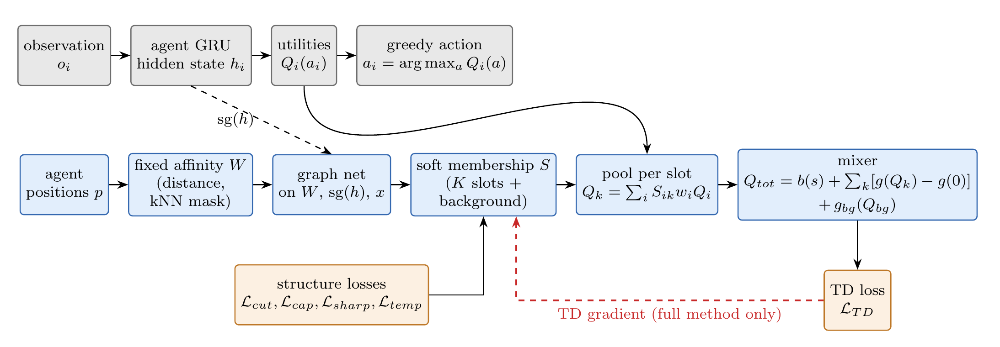

# DynaCoalition Architecture (Implementation Reference)

This file matches the approved literature survey (`CS839_RL_Literature_Survey.pdf`) and supersedes the earlier "DynaCoalition in a Nutshell" draft and `ARCHITECTURE_SPEC.md`, both of which it absorbs. **If anything here conflicts with an older doc, this file wins.** For why the design changed from the proposal, see [PROJECT_CONTEXT.md](PROJECT_CONTEXT.md); for background concepts, see [CONCEPTS_PRIMER.md](CONCEPTS_PRIMER.md); for the experiments, see [EXPERIMENT_PLAN.md](EXPERIMENT_PLAN.md).

## 1. The idea

In cooperative MARL, agents share one team reward, but usually only a few agents need to work closely together at any moment (e.g. three agents pushing one package). QMIX mixes all agents' utilities in one flat monotone function. **DynaCoalition adds a middle step: agents are softly grouped into coalitions at every timestep, utilities are pooled inside each coalition, and a single shared monotone network combines the coalition values.**

**One-line summary — QMIX with a different mixer.** Only the agent networks run at execution. Coalitions are a training-time structure: they shape **credit assignment** (how the team's TD error is distributed among agents), not how agents act.

**The question we test:** does letting the team TD loss shape the grouping give better groups and better return than learning the grouping from structure alone?

## 2. Figure



**Figure 1 (from the literature survey).** Grey boxes are used at execution; blue boxes exist only during training. The graph network reads stop-gradient hidden states, sg(h). The red dashed arrow marks the TD gradient into the memberships, which is blocked in the detached ablation.

**Walkthrough**

1. **Agent network:** each agent's GRU gives a hidden state `h_i` and utilities `Q_i`. This is all that runs at test time.
2. **Affinity:** a **fixed, parameter-free** distance-based graph `W` over nearby agents, recomputed every step from positions.
3. **Membership `S`:** a small graph network turns `W`, `sg(h)` and features `x` into soft coalition assignments over `K` slots plus one background column for agents in no coalition.
4. **Pooling:** each coalition's value is a non-negatively weighted sum of its members' utilities.
5. **Mixing:** **one shared** monotone network `g` turns each coalition value into a contribution to `Q_tot`, and a separate head `g_bg` handles the background slot.

## 3. Notation and tensor shapes

| Symbol | Meaning | Shape |
|---|---|---|
| B, T, N | batch (episodes), timesteps, agents | |
| K | number of coalition slots (excludes background) | hyperparameter, **not tied to the number of packages**. Agreed rule: **K = N/2** (6 at N = 12, 12 at N = 24), which never equals M = N/3 |
| `obs` | per-agent observations | (B, T, N, obs_dim) |
| `s` | global state (training only) | (B, T, state_dim) |
| `p` | agent positions | (B, T, N, 2) |
| `x` | agent features: position, velocity, nearest-package info (**never actions or utilities**) | (B, T, N, x_dim) |
| `h` | agent GRU hidden states | (B, T, N, H) |
| `q` | agent Q-values for all actions | (B, T, N, A) |
| `q_sel` | Q-value of the chosen action | (B, T, N) |
| `W` | fixed affinity | (B, T, N, N) |
| `S` | soft memberships; column 0 = background | (B, T, N, K+1) |
| `Q_k` | pooled coalition values, k = 0..K | (B, T, K+1) |
| `m_k`, `z_k` | coalition size, member features | (B, T, K+1), (B, T, K+1, x_dim) |
| `Q_tot` | team value | (B, T, 1) |
| `mask` | real (non-padded) steps | (B, T, 1) |

## 4. Forward pass (per timestep)

**1. Affinity (fixed, no parameters).** With dᵢⱼ the distance between agents i and j, and M a symmetric kNN/radius mask:

&nbsp;&nbsp;Wᵢⱼ = Mᵢⱼ · exp(−dᵢⱼ² / σ²), with Wᵢᵢ = 0.

&nbsp;&nbsp;It's recomputed every step from positions, and the same W is used in every variant. (The proposal's **learned** affinity σ(eᵢᵀeⱼ/√d) is gone: nothing would train it in the detached ablation, so the comparison would be unfair.)

**2. Memberships:**

&nbsp;&nbsp;S = softmax( GNN(W, sg(h), x) / T ) ∈ ℝ^{N×(K+1)}

- sg(h) is a stop-gradient: the graph network reads h, but no gradient flows back into the agent GRU along this path.
- Each row sums to 1. Column 0 is the background slot.

**3. Mixing inputs:** S_mix = sg(S) if `detach` else S. **Everything below uses S_mix.**

**4. Per-agent weights:** wᵢ = softplus(f(hᵢ, s)) ≥ 0. Not stop-gradient, so TD trains it and reaches h through it.

**5. Pooling (k = 0..K):**
- Q_k = Σᵢ S_mix[i,k] · wᵢ · q_selᵢ
- m_k = Σᵢ S_mix[i,k]
- z_k = Σᵢ S_mix[i,k] · xᵢ / (m_k + ε)

**6. Team value:**

&nbsp;&nbsp;Q_tot = b(s) + Σ_{k=1..K} [ g(Q_k; φ_k) − g(0; φ_k) ] + g_bg(Q_0; s), with φ_k = (s, z_k, m_k)

- **g is one shared network** applied to each slot (hypernetwork weights from φ_k, made non-negative, with monotone activations), so the mixer doesn't depend on slot order. Slot labels are arbitrary and can swap between steps, so per-coalition mixers (an early draft) are wrong here.
- **Subtracting g(0; φ_k)** makes empty slots contribute zero.
- **g_bg** is a separate monotone head for the background slot, so unassigned agents still get TD gradient and keep learning.
- **g and g_bg must be nonlinear.** With a linear g, coalitions can't model interactions among members. (Grouping would still rescale credit — the old "it collapses to VDN and grouping wouldn't matter" claim was wrong.)
- `m_k` lets g tell a 1-agent group from a 3-agent group; `z_k` gives it the members' average features.

**Why execution stays decentralized:** S, wᵢ, m_k, z_k, and b(s) don't depend on current actions or on any Qᵢ, and every factor multiplying a utility is non-negative:

&nbsp;&nbsp;∂Q_tot/∂Qᵢ = Σ_{k≥1} (∂g/∂Q_k)·S_ik·wᵢ + (∂g_bg/∂Q_0)·S_i0·wᵢ ≥ 0

So each agent's greedy action also maximizes Q_tot (the IGM property), exactly the guarantee QMIX gives.

## 5. Losses

L = L_TD + β_cut·L_cut + β_cap·L_cap + β_sharp·L_sharp + β_temp·L_temp

Let S_c = S[..., 1:] (the coalition columns, without background) and D = diag(Σⱼ Wᵢⱼ).

| Term | Formula | Purpose | Notes |
|---|---|---|---|
| **L_TD** | masked mean of (Q_tot − sg(y))² | Main RL loss; trains agents, mixer, and (full method only) S | Double-Q target; see Section 7 |
| **L_cut** | −Tr(S_cᵀ W S_c) / (Tr(S_cᵀ D S_c) + ε) | Pulls linked agents into the same coalition | Per timestep, then masked mean. W is parameter-free. Keep β_cut small |
| **L_cap** | (1/K) Σₖ ReLU(m_k − c)² | Prevents one coalition absorbing everyone | The cap c is tuned, **not** set from task knowledge |
| **L_sharp** | mean over agents of −Σₖ Sᵢₖ log Sᵢₖ (all K+1 columns) | Prevents fuzzy, uniform rows | Small for most of training, raised late |
| **L_temp** | (1/N) Σᵢ ‖S_iᵗ − S_iᵗ⁻¹‖² | Prevents flickering between steps | Within each sampled sequence |

**The structure losses always use the un-detached S,** so in the detached ablation the graph network trains from these losses only. MinCutPool's orthogonality term is deliberately **not** used: it forces equal-sized coalitions, and transport has uneven and empty ones; L_cap + L_sharp replace it.

## 6. Variants and the key experiment

| Variant | `detach` | Membership source | TD gradient reaches S? |
|---|---|---|---|
| **Full DynaCoalition** | False | Graph network (TD + structure losses) | Yes |
| **Detached ablation** | True | Graph network (structure losses only) | No |
| **Oracle (contact)** | n/a | One-hot from ground-truth contact labels (background = column 0) | n/a |
| **Position clustering** | n/a | Spatial clustering of p (k-means or soft RBF), same mixer | n/a |
| **Random S** | n/a | Random memberships (e.g., Dirichlet) | n/a |

The full method and the detached ablation are **identical except for the detach**, which is what makes the comparison valid. The controls replace S with a fixed or generated matrix of the same shape and pass it through the same mixer. VAST-spatial uses its own QMIX-over-K operator (see [EXPERIMENT_PLAN.md](EXPERIMENT_PLAN.md)). Outer baselines: QMIX and VDN.

## 7. Training details

**Target networks:** copies of the agent network, graph network, w-head, g, g_bg, and b. W has no parameters, so it needs no copy.

**Target-update rule:** soft Polyak, θ⁻ ← τθ + (1−τ)θ⁻ with τ ≈ 0.005, **identical for all methods** (not the proposal's periodic hard copy), so the target's grouping drifts smoothly and the comparison stays fair.

**The Double-Q target:**
```python
q_online = agent(obs)                       # (B, T+1, N, A), unrolled from t=0
q_target = target_agent(obs)                # own hidden states

q_sel   = q_online[:, :-1].gather(-1, actions).squeeze(-1)
a_star  = q_online[:, 1:].argmax(-1, keepdim=True)          # online chooses
q_next  = q_target[:, 1:].gather(-1, a_star).squeeze(-1)    # target evaluates

Q_tot, S, aux = coalition_mix(q_sel, h[:, :-1], x[:, :-1], s[:, :-1], p[:, :-1], detach=detach, temperature=T)
with torch.no_grad():
    Q_next, _, _ = target_coalition_mix(q_next, h_tgt[:, 1:], x[:, 1:], s[:, 1:], p[:, 1:], detach=False, temperature=T)
y = r + gamma * (1 - done) * Q_next
L_td = (((Q_tot - y.detach()) ** 2) * mask).sum() / mask.sum()
```

**Schedules (defaults, to tune):**
- ε anneals from 1.0 down to about 0.05.
- Temperature T = 1.0 for about the first 80% of training, then annealed to about 0.3. Sharpening early saturates the softmax and kills the TD gradient, silently turning the full method into the ablation.
- β_sharp starts small and is raised in the final phase.

**Logged at every evaluation:**
- ‖∇_GNN L_TD‖, the TD gradient's size at the graph network (full method only),
- the mean max membership,
- K_eff, the number of slots with m_k > ε.

## 8. Interfaces (to agree at the first sync)

```python
def coalition_mix(q_sel, h, x, s, p, *, detach: bool, temperature: float):
    """Returns (Q_tot [B,T,1], S [B,T,N,K+1], aux) where aux = {"W": W, "m": m, "z": z}."""

def compute_structure_loss(S, W, mask, *, cap: float, betas: dict) -> dict:
    """Returns {"cut": ..., "cap": ..., "sharp": ..., "temp": ..., "total": ...}."""
```

**The environment contract** (keys in each sampled batch). A batch holds **T transitions and the T+1 states they run between**: observation-like keys carry T+1 steps so the Double-Q target in Section 7 can bootstrap from t+1, and transition keys carry T.

| Key | Shape | Notes |
|---|---|---|
| `obs` | (B, **T+1**, N, obs_dim) | Agent inputs |
| `state` | (B, **T+1**, state_dim) | Global state for the mixer |
| `positions` | (B, **T+1**, N, 2) | For W |
| `agent_features` | (B, **T+1**, N, x_dim) | x |
| `avail_actions` | (B, **T+1**, N, A) | All ones in VMAS transport |
| `actions` | (B, T, N, 1) int | Chosen actions |
| `gt_coalitions` | (B, T, N) int | 0 = no contact, k = in contact with package k |
| `rewards` | (B, T, 1) | Shared team reward |
| `dones` | (B, T, 1) | Terminal flags |
| `mask` | (B, T, 1) | Real steps |

`src/dc/contracts.py` is the executable version of this table: `validate_batch(batch, spec)` enforces every shape, dtype and range above, and `src/dc/envs/fake.py` emits batches that satisfy it. If the two ever disagree, fix the code to match this table or change both together.

## 9. Pseudocode

**Algorithm 1: CoalitionMix** — computes Q_tot from chosen-action utilities.
1. W ← fixed distance-based affinity from p
2. S ← softmax(GNN(W, sg(h), x) / T)  (column 0 = background)
3. S_mix ← sg(S) if detach else S
4. w ← softplus(f(h, s))
5. Pool with S_mix: Q_k for k = 0..K; compute m_k and z_k from S_mix
6. Q_tot ← b(s) + Σ_{k≥1}[g(Q_k; s, z_k, m_k) − g(0; s, z_k, m_k)] + g_bg(Q_0; s)
7. Return Q_tot, S

**Algorithm 2: Training**
1. Initialize θ, set θ⁻ ← θ, create replay buffer D
2. Repeat:
   1. Collect episodes in vectorized VMAS (ε-greedy on each agent's Qᵢ); add them to D
   2. Sample sequences; unroll the agent GRUs to get h and Qᵢ
   3. Q_tot, S ← CoalitionMix(chosen Qᵢ, h, x, s, p; θ, detach)
   4. y ← Double-Q target from the target agents and target CoalitionMix (no gradient)
   5. L ← L_TD + weighted structure losses
   6. Gradient step with clipping; log ‖∇_GNN L_TD‖
   7. Polyak-update the target networks (same rule for all methods)
   8. Update schedules (ε; late in training, T and β_sharp)
   9. Periodically evaluate: return, packages delivered, ARI, switch rate

## 10. Unit tests (synthetic inputs, no environment needed)

- **Monotonicity:** ∂Q_tot/∂q_selᵢ ≥ 0 across random inputs.
- **Detach:** ‖∇_GNN L_TD‖ > 0 with `detach=False`, and exactly 0 with `detach=True`, including through m_k and z_k.
- **Permutation invariance:** permuting coalition slots 1..K leaves Q_tot unchanged.
- **Empty slots:** a slot with S[:, k] = 0 contributes 0.
- **Background:** an agent fully in column 0 still receives a nonzero TD gradient on q_sel.
- **Cut loss:** it recovers planted partitions on synthetic graphs, and the degenerate cases (one group, uniform rows) score −1, which confirms L_cap and L_sharp are needed.
- **sg(h):** structure losses produce no gradient on agent GRU parameters.

## 11. Common-bugs checklist

- [ ] The mask is applied in every loss average, including the structure losses.
- [ ] `y.detach()` is used, and the target is computed under `no_grad`.
- [ ] Double Q is correct: the online network chooses and the target network evaluates.
- [ ] No off-by-one between t and t+1 slices.
- [ ] (1 − done) zeroes the future value at terminal steps.
- [ ] GRU hidden states are reset at the start of each episode, for both online and target networks.
- [ ] The target copy includes the graph network, w-head, g, g_bg, and b.
- [ ] The detach covers Q_k, the background, m_k, and z_k (everything uses S_mix).
- [ ] x never contains current actions or Q-values.
- [ ] ε is added to the denominators of z_k and L_cut.
- [ ] All tensors stay on one device (no per-step CPU↔GPU transfers).
- [ ] VMAS per-agent lists are stacked into (num_envs, N, …) tensors before storage.
